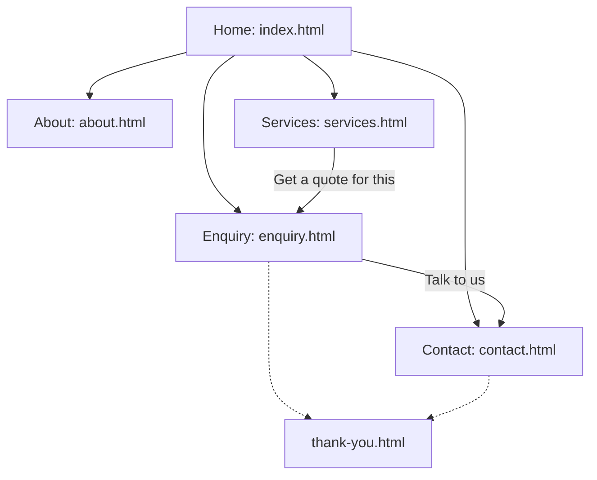

# Nexus Pro

A website for Nexus Pro, a Strand-based studio that builds websites and business systems for small businesses.

- **Part 2:** CSS styling and responsive design
- **Part 3:** JavaScript functionality, forms and validation, SEO, GitHub and deployment

Live site: https://nexus-pro.netlify.app

## Student information

| | |
| --- | --- |
| Student name | Landon Ferguson |
| Student number | ST10531343 |
| Module | Web Development (Introduction), WEDE5020 |
| Institution | The Independent Institute of Education (IIE), Emeris Cape Town-City |
| Assignment | Part 3: Enhancing the Functionality and SEO of my website |

## AI use disclosure

AI use disclosure:  chat gbt guided me in  updateing the website. all content, code and  pictures are my own work.chat gbt told the erros i made and how to fix them.
## Website goals and objectives

**Goal.** Present part 3 as a credible web design and systems studio for local businesses.

**Objectives.**

1. fix five public pages, part 2 states i left out some pages and i filled them in. (home, about, services, enquiry, contact) that are reachable from every page in one click through the navigation. the assaisment alsow sateded that i  should  put these  pages in order.
2. Let a visitor(Teacher) get an estimate of cost, delivery time and start date  and idea in a single form submission.
3. Work on screens from 375px to 1280px and wider without horizontal scrolling, with a hamburger menu on mobile and tablet.
4. Apply on-page SEO to every page and local SEO for Strand, targeting seven keyword phrases (see the SEO section).
5. Keep the first page load light by downloading heavy media (video, audio) only when needed.
6. Be operable by keyboard and screen reader, aiming at the WCAG 2.2 guidelines (W3C, 2023).

## Key features and functionality

| Feature | What it does | Where |
| --- | --- | --- |
| Hamburger navigation | Collapsible menu on mobile and tablet, full links on desktop; keyboard and Escape support | `script.js` section 9 |
| Service catalogue | Services loaded from JSON, with search, category filter, five sort options, URL state | `services.html`, `js/services.js` |
| Details modal | Native dialog with the service image, features, price and a link that pre-selects the enquiry form | `js/services.js`, `script.js` |
| FAQ accordion and About tabs | Accessible interactive content following the WAI-ARIA patterns (W3C, n.d.) | `index.html`, `about.html` |
| Instant quote | Validated enquiry form returns cost range, delivery time and availability | `enquiry.html`, `js/forms.js` |
| Contact email | Validated contact form compiles an email the visitor sends from their email app | `contact.html`, `js/forms.js` |
| Service-area map | Interactive map with a service-area circle and an opt-in location check | `js/map.js` |
| Responsive images | WebP and JPEG showcase pictures with `srcset` and `sizes`, and scalable SVG illustrations | `index.html`, `assets/images/` |
| Animations | Scroll reveal, accordion and menu transitions, drifting background glows | `style.css`, `script.js` |

## Sitemap



```
/
├── index.html      Home
├── about.html      About
├── services.html   Services
├── enquiry.html    Enquiry
├── contact.html    Contact
├── thank-you.html  (not indexed)
└── 404.html        (not indexed)
```

## Timeline and milestones

| Milestone | Status |
| --- | --- |
| Part 1: proposal and HTML structure | Completed |
| Part 2: CSS styling and responsive design (submitted 1 October 2026) | Completed; marked 66/100 |
| Part 2 marks and feedback received | Completed |
| Part 3 build: JavaScript, forms, SEO, security (2 November 2026) | Completed |
| Part 2 feedback corrections: hamburger menu, images, decoration, tablet scale, README (3 November 2026) | Completed |
| Push to GitHub with descriptive commits | Ready to push |
| Deploy to Netlify and test the live forms | To do on the submission day |
| Submit repository link on the Learning Management System | To do on the submission day |

## Pages

| File | Purpose |
| --- | --- |
| `index.html` | Hero, "Why now" cards, responsive showcase images, FAQ accordion |
| `about.html` | Profile, tabbed "How we work", "Why it matters" |
| `services.html` | Dynamic service catalogue with search, filter, sort and a details modal |
| `enquiry.html` | Quote form that returns an estimated cost, delivery time and earliest start date |
| `contact.html` | Contact form that compiles an email, plus an interactive service-area map |
| `thank-you.html` | Confirmation page for a non-JavaScript form submission (not indexed) |
| `404.html` | Friendly error page (not indexed) |

## Project structure

```
nexus-pro/
├── index.html, about.html, services.html, enquiry.html, contact.html
├── thank-you.html, 404.html
├── style.css                 (one external stylesheet, sections 1-13)
├── script.js                 (site-wide: grass, profile pop, music, reveal, accordion, tabs, modal, share, menu)
├── js/
│   ├── services.js           (fetch, render, search, filter, sort, modal content)
│   ├── forms.js              (validation, AJAX submission, quote engine, email compiler)
│   └── map.js                (Leaflet map and location check)
├── data/services.json        (the service catalogue)
├── robots.txt, sitemap.xml, _headers
├── README.md
└── assets/
    ├── purple-sky-background-600.jpg, -900.jpg, -1200.jpg
    ├── nexus-pro-social-preview.jpg, favicon.svg
    ├── grass.webm, calm.m4a
    ├── images/               (8 service illustrations, 3 showcase pictures in 3 sizes and 2 formats)
    └── vendor/leaflet/       (Leaflet 1.9.4, self-hosted, with its licence)
```

## How to run locally

Extract the project first, then open `index.html` in a browser. `services.html` loads `data/services.json` with `fetch()`, which browsers block on `file://` addresses, so it falls back to an identical offline copy in `data/services-fallback.js` (keep the two files in step when editing prices). A local server is still the best way to preview:

```
python -m http.server 8000      # then open http://localhost:8000
```

(or use the VS Code "Live Server" extension). The map needs an internet connection for its tiles (OpenStreetMap contributors, n.d.).

The contact form's compiled email is configured to open a message addressed to `Landonfergsuon191@gmail.com`. The visitor reviews and sends the email from their own email application. Netlify Forms separately records form submissions when the site is deployed on Netlify.

## Part 3 requirements and where they are met

| Requirement | Where |
| --- | --- |
| Interactive elements: accordion | FAQ on `index.html`; `script.js` section 5 (WAI-ARIA pattern, keyboard support) |
| Interactive elements: tabs | "How we work" on `about.html`; `script.js` section 6 |
| Interactive elements: modal | Service details on `services.html`; native `<dialog>` element (MDN Web Docs, n.d.); `script.js` section 7 |
| Interactive map | `contact.html`, `js/map.js`, using the Leaflet library (Agafonkin, 2023) |
| Animations and transitions (CSS and JS) | Scroll reveal, accordion and menu height transitions, tab fade, modal entrance, drifting glows, grass and profile effects |
| Advanced DOM manipulation | `<template>` cloning, `DocumentFragment`, `replaceChildren`, event delegation, `IntersectionObserver`, `inert`, dynamic ARIA state |
| Dynamic content | Services loaded from `data/services.json` and rendered by JavaScript |
| Search, filter and sort | `js/services.js`; state mirrored in the URL (`?q=&cat=&sort=`) |
| `enquiry.html` processed response | `js/forms.js` section 4: validated input becomes a cost range, delivery time and availability |
| `contact.html` compiled email | `js/forms.js` section 5: validated input compiled into a `mailto:` message to the recipient in `CONFIG.EMAIL` |
| Form elements | `input` (text, email, tel, date, radio, checkbox), `select`, `textarea`, `fieldset`, `label` |
| HTML5 validation attributes | `required`, `type="email"`, `type="tel"`, `type="date"` with `min`/`max`, `minlength`, `maxlength`, `pattern` |
| Specific formats | South African phone numbers, names, dates (not in the past, within 12 months), character lengths with a live counter |
| Form `action` attribute | `action="thank-you.html"` on both forms |
| Client-side validation, error handling | `js/forms.js` section 2: inline messages, `aria-invalid`, error summary, focus on first error |
| AJAX form submission | `fetch()` POST to the form's `action` URL; Netlify Forms records the submission (Netlify, n.d.) |
| GitHub | Multiple descriptive commits, this README, push to the remote repository (GitHub, n.d.) |

## Search Engine Optimisation

### On-page SEO

| Item | What was done |
| --- | --- |
| Keyword research | Table below |
| Title tags and meta descriptions | A unique title (under 60 characters) and description (about 135 to 150 characters) on every page |
| Header tags | Exactly one `<h1>` per page, then `<h2>` and `<h3>` in order |
| Image optimisation | Descriptive file names (`showcase-booking-900.jpg`), `alt` text on every image (empty for the decorative sky), `width` and `height` set, `srcset`, WebP with JPEG fallback, lazy loading |
| URL structure | Short, lowercase, hyphenated file names: `/services.html`, `/enquiry.html` |
| Internal linking | Contextual links in body copy between home, about, services, enquiry and contact, plus a footer navigation on every page |
| Mobile-friendliness | Viewport tag, mobile-first CSS, hamburger menu, no horizontal scrolling at 375px, tap targets of at least 44px |
| Structured data | `ProfessionalService` (local business) and `FAQPage` JSON-LD on the home page (schema.org, n.d.) |
| Social previews | Open Graph and Twitter Card tags with a 1200 x 630 preview image |

**Keyword research.** Keywords were chosen from the services offered and the local market (Strand and the Western Cape), grouped by search intent and mapped to one page each so that pages do not compete.

| Keyword phrase | Intent | Target page |
| --- | --- | --- |
| web design Strand | Local, commercial | `index.html` |
| website developer Strand | Local, commercial | `about.html` |
| affordable website design Western Cape | Commercial | `services.html` |
| small business website South Africa | Commercial | `index.html`, `services.html` |
| online booking system for small business | Commercial | `services.html` |
| get a website quote | Transactional | `enquiry.html` |
| contact web developer Strand | Navigational | `contact.html` |

### Off-page SEO (plan and what the site supports)

| Item | Plan |
| --- | --- |
| Backlinks | Ask local partners, clients and the institution for a link to the live site; list the business in reputable local directories; publish helpful local guides that others will link to. Quality over quantity. |
| Social media | Open Graph and Twitter Card data make shared links show a title, description and image, and the "Share this site" button uses the Web Share API with a copy-link fallback. |
| Local SEO | `ProfessionalService` data with Strand as the locality and a 25 km service area (schema.org, n.d.), "Strand" in titles and copy, an interactive service-area map, and a Google Business Profile to be created and linked to the site. |

### Additional requests

| Item | Where |
| --- | --- |
| `robots.txt` | Allows all public pages and points to the sitemap (Google, n.d.). |
| `sitemap.xml` | Lists the five public pages with `lastmod` (Sitemaps.org, n.d.). |
| Page speed | `defer` on every script; page-specific scripts only where needed; the 2.3 MB grass video is not downloaded until first needed (`preload="none"`); the 1.5 MB music file loads metadata only; responsive images with dimensions, WebP and lazy loading; `font-display: swap`; asset cache headers. |
| Security | Content Security Policy and other security headers set in `_headers` (`X-Content-Type-Options`, `X-Frame-Options`, `Referrer-Policy`, `Permissions-Policy`, HSTS); all dynamic content inserted with `textContent`, never `innerHTML`; honeypot spam trap; input cleaning; Leaflet self-hosted so no third-party script runs on the site; external links use `rel="noopener noreferrer"`; no secrets in client code. |

## Deploying

The site is configured for deployment on Netlify. The live site address used by the canonical URLs, Open Graph metadata, structured data, sitemap and robots file is `https://nexus-pro.netlify.app`. The contact and enquiry forms use Netlify Forms and require a successful deployed-site test to confirm that submissions appear in the Netlify dashboard.

GitHub Pages also serves the pages and scripts (GitHub, n.d.), but only Netlify Forms records form submissions; on GitHub Pages the quote and the compiled email still work and the page tells the visitor that the submission could not be recorded.

## Testing carried out

Automated browser tests (headless Chromium) at 375px, 768px and 1280px covered: no script errors on any page, no horizontal scrolling, hamburger menu open, close and Escape, search, filter, sort and URL state, modal open and close, accordion and tab keyboard control, every validation rule on both forms, the quote calculation, the AJAX success and failure paths, the honeypot, the compiled email, map creation, and image loading. Map tiles, web fonts and the live Netlify form endpoint can only be confirmed on the deployed site.

## Changelog

### Part 2 feedback corrections (3 November 2026)

Part 2 was marked 66/100. Each correction below is tied to a comment in the marking feedback.

| Feedback received | What was changed | Files |
| --- | --- | --- |
| Navigation (0/5): "Menu should be switched to a hamburger menu in mobile and tablet view." | Added a hamburger button with an animated icon. Below 64em the links collapse into a menu that opens with a height transition, closes on Escape, outside click and resize, and uses `aria-expanded`, `aria-controls` and `inert`. From 64em the full links show and the button is hidden. If JavaScript fails, the links stay visible. | `style.css` section 13a, `script.js` section 9, all HTML pages |
| Images (0/5): "No images." | Added a "What we build" section with three showcase pictures, each in three widths and two formats (`<picture>`, `srcset`, `sizes`, WebP with JPEG fallback, `loading="lazy"`, `width` and `height`, descriptive `alt`). Added eight SVG service illustrations shown on the service cards and in the modal. | `index.html`, `services.html`, `js/services.js`, `data/services.json`, `assets/images/`, `style.css` section 13e |
| Layout adjustment (3/5): "Tablet view could be improved, elements could fill the screen better." | On tablets (600px to 1023px) the root font size is raised to 112.5% and the content width to 46rem, so panels, cards and spacing fill the screen. | `style.css` section 13b |
| Layout adjustment: "Grass blocks off text in mobile view." | The grass video now sits behind the content on mobile and tablet (and is softer), and stays in front only on desktop where the content is on the right. | `style.css` section 13c, `script.js` section 1 |
| Typography adjustment (3/5): "Text could be larger in tablet view, it is small and a bit difficult to read." | Larger body text on tablets through the root size and larger paragraph, card and accordion text. | `style.css` section 13b |
| Decoration and colour (3/5): "Insufficient use of decoration." | Added drifting gradient glows in the hero, gradient hero text, accent lines on eyebrows and titles, gradient card top borders, icon badges on the "Why now" cards, gradient buttons with a glow on hover, and a soft footer gradient. | `style.css` section 13d, `index.html` |
| GitHub (0/5): "No use of GitHub!" | The project is now a Git repository with multiple descriptive commits, ready to push to GitHub. | `.git` history |
| README (2/5): missing student information, goals and objectives, key features, timeline and milestones, sitemap and references. | Added every missing section: Student information, Website goals and objectives, Key features and functionality, Sitemap (diagram and tree), Timeline and milestones, and References. | `README.md` |
| References (0/5): "No references!" | Added in-text Harvard citations throughout this document and a matching reference list. | `README.md` |
| AI disclosure penalty | Added an AI use disclosure section. | `README.md` |
| Feedback for Part 1 (5/10): "Could not give feedback for part 1." | No Part 1 feedback was available. The changelog now records every Part 2 correction in detail, as required. | `README.md` |

### Part 3

Preview fix (3 November 2026)
- Added `data/services-fallback.js` and a fallback in `js/services.js` and `js/forms.js` so the services catalogue and the quote form also work when the site is opened directly from disk.

New files
- Added `services.html` with a dynamic catalogue loaded from `data/services.json`; search, category filter, five sort options, result count announced to screen readers, empty and error states, filters stored in the URL.
- Added a details modal using the native `<dialog>` element, filled by JavaScript, with a link to the enquiry form that pre-selects the service.
- Added `enquiry.html` with a full quote form and a calculated response (cost range, delivery time, earliest start, proposed start and completion).
- Rebuilt `contact.html`: a validated form with name, email, phone, topic and message that compiles an email preview with an "Open in my email app" button and a copy fallback.
- Added an interactive Leaflet map to `contact.html` with a service-area circle and an opt-in "Am I in the service area?" location check.
- Added `thank-you.html`, `404.html`, `robots.txt`, `sitemap.xml`, `_headers`, `favicon.svg` and a social preview image.
- Added `js/services.js`, `js/forms.js` and `js/map.js`; added `data/services.json`; added Leaflet 1.9.4 (self-hosted) under `assets/vendor/leaflet/`.

Changes to existing files
- `index.html`: added a FAQ accordion, hero buttons, contextual internal links, structured data, Open Graph tags and a unique title and description.
- `about.html`: added a tabbed "How we work" section; changed the button text "Click here" to "Get in touch" so link text describes its destination; added a unique title and description.
- All pages: added a skip link, Services and Enquiry in the navigation, a footer navigation and share button, canonical tags, favicon, and `width` and `height` on images and the video.
- `script.js`: the contact-form code moved to `js/forms.js`; the grass video downloads only when first needed; added scroll reveal, accordion, tabs, modal handling and the share button.
- `style.css`: added sections 8 to 13.
- Renamed `sky-600.jpg`, `sky-900.jpg` and `sky-1200.jpg` to `purple-sky-background-600.jpg`, `-900.jpg` and `-1200.jpg` (descriptive file names) and updated every reference.
- Changed the music `<audio>` from `preload="auto"` to `preload="metadata"` and the grass `<video>` from autoplay to a lazy start with `preload="none"` (about 3.9 MB less data on first load).

### Part 2

- Created the external stylesheet `style.css` and linked it from all pages. All inline styles were removed.
- Split the single page into three pages (`index.html`, `about.html`, `contact.html`) with the same header, navigation and footer.
- Added a CSS reset and base styles (font family, font size, colour scheme, spacing) as custom properties.
- Added a typography scale (ratio 1.333) and applied weight, line height and letter spacing.
- Built the page layout with CSS Grid (`grid-template-areas`) and the header, navigation, hero and form with Flexbox.
- Added borders, shadows and colours to cards, buttons, form fields and the profile photo.
- Added `:hover`, `:focus` and `:active` states to links, cards, buttons and form fields.
- Added breakpoints at 37.5em and 64em. The card grid and the profile change between one and two columns.
- Converted the sky background to a `<picture>` element with three image sizes (`srcset` and `sizes`).
- Replaced the canvas-processed grass with a pre-made transparent video (`assets/grass.webm`).
- Tested at 375px, 800px and 1280px widths in Chrome with no horizontal scrolling and no script errors.

## References

Agafonkin, V. (2023) *Leaflet: an open-source JavaScript library for interactive maps*. Available at: https://leafletjs.com/ (Accessed: 3 November 2026).

GitHub (n.d.) *GitHub Pages documentation*. Available at: https://docs.github.com/en/pages (Accessed: 3 November 2026).

Google (n.d.) *Introduction to robots.txt*. Google Search Central. Available at: https://developers.google.com/search/docs/crawling-indexing/robots/intro (Accessed: 3 November 2026).

MDN Web Docs (n.d.) *\<dialog\>: The Dialog element*. Mozilla. Available at: https://developer.mozilla.org/en-US/docs/Web/HTML/Reference/Elements/dialog (Accessed: 3 November 2026).

Netlify (n.d.) *Netlify Docs*. Available at: https://docs.netlify.com/ (Accessed: 3 November 2026).

OpenStreetMap contributors (n.d.) *Copyright and licence*. Available at: https://www.openstreetmap.org/copyright (Accessed: 3 November 2026).

schema.org (n.d.) *LocalBusiness*. Available at: https://schema.org/LocalBusiness (Accessed: 3 November 2026).

Sitemaps.org (n.d.) *Sitemaps XML format*. Available at: https://www.sitemaps.org/protocol.html (Accessed: 3 November 2026).

W3C (2023) *Web Content Accessibility Guidelines (WCAG) 2.2*. Available at: https://www.w3.org/TR/WCAG22/ (Accessed: 3 November 2026).

W3C (n.d.) *ARIA Authoring Practices Guide: patterns*. Available at: https://www.w3.org/WAI/ARIA/apg/patterns/ (Accessed: 3 November 2026).
